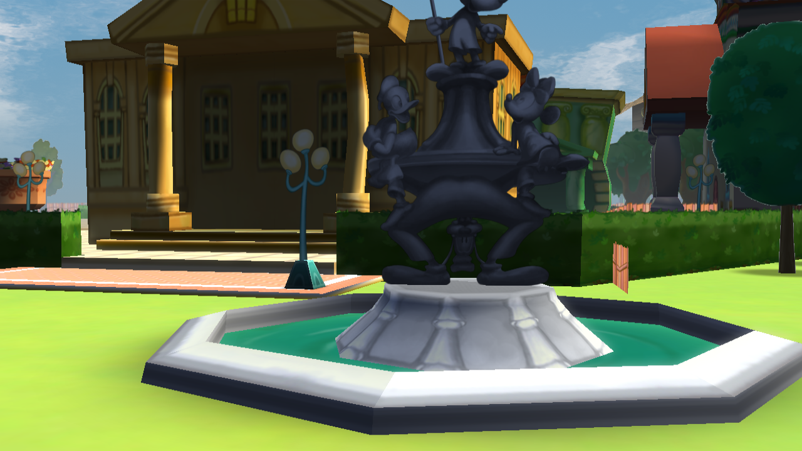
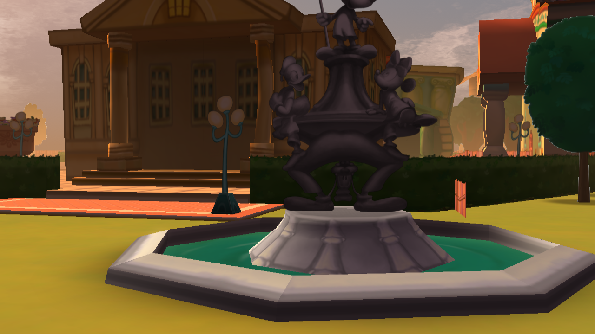
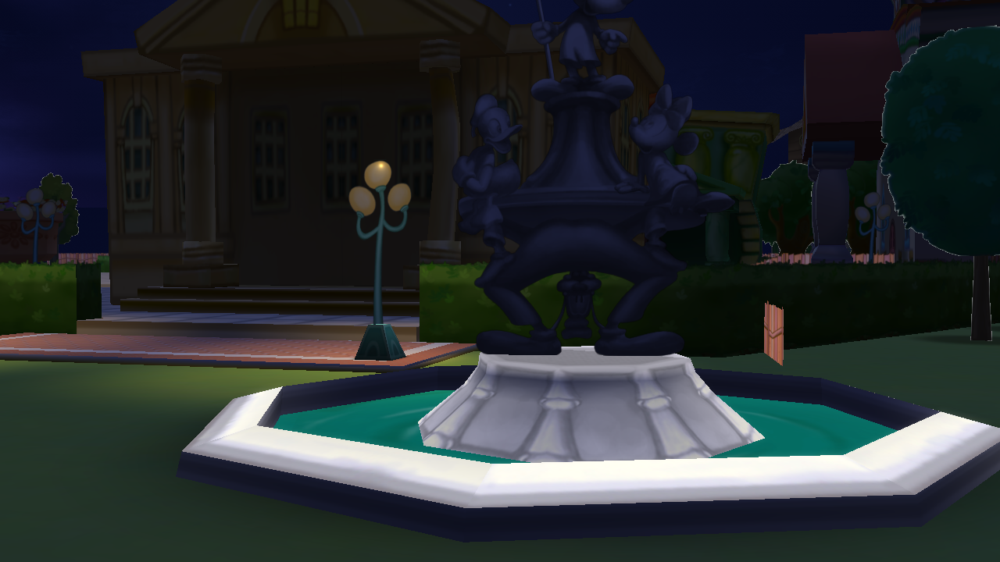

# OutdoorLighting (Toontown / Panda3D)

> [!WARNING]
> **Unfinished proof of concept — use at your own risk.** This lighting system is
> still under development, some features may be incomplete, and testing has been
> limited to a small number of setups. Shader behavior, visual quality, stability,
> and performance may vary across graphics cards, drivers, and Panda3D builds.
> Expect to debug or adapt it for your source and renderer before using it in a
> release. Back up your source before running the installer.

A portable copy of this source's outdoor lighting stack, including the procedural sky and all GLSL shaders used by lighting, shadows, water, post processing, and sun rays.

## Project status and compatibility

This repository is an **unfinished proof of concept**, not a production-ready,
drop-in lighting replacement. Some paths are experimental or optional, and the
system has not been broadly tested across Toontown sources, Panda3D versions,
graphics cards, or graphics drivers. Different GPU shader compilers and render
backends can produce rendering differences or failures; optional effects may
need to be disabled or adjusted for a target client. Validate it in your own
client and renderer before distributing or shipping it.

## Screenshots

These are Panda3D render-window captures from inside Toontown Central, beside the fountain and looking into the central plaza. They use the real playground DNA and TTC neighborhood model with the outdoor lighting module active. The harness also registers the live client ground and shadow cull bins before loading the scene, which keeps the plaza floor in the correct render order. The harness skips login and avatar setup and does not add stand-in scene geometry. It loads the playground scene directly, so it does not reproduce the full client HUD, avatar, or every runtime-loaded prop.

### Daylight



### Golden hour



### Night



To regenerate these captures from the source checkout, run:

```powershell
.\Panda3D\python\ppython.exe .\OutdoorLighting\capture_playground.py
```

## Easy install (Windows / PowerShell)

Clone either source and this package, then point the package's installer at the local game repository root (the folder containing `toontown`):

```powershell
# Set this to the folder where you cloned Toontown-OutdoorLighting.
$PackageRoot = 'C:\src\Toontown-OutdoorLighting'

# Open Toontown
powershell -ExecutionPolicy Bypass -File "$PackageRoot\Install-OutdoorLighting.ps1" `
  -SourceRoot C:\src\open-toontown

# Toontown School House
powershell -ExecutionPolicy Bypass -File "$PackageRoot\Install-OutdoorLighting.ps1" `
  -SourceRoot C:\src\Toontown-School-House
```

The installer copies the four Python modules to `toontown/hood`, copies shaders to `toontown/shaders`, and wires `OutdoorLighting.begin()` / `end()` into the standard outdoor `toontown/safezone/Playground.py` hooks when it recognizes them. If your Playground file has a different layout, it stops before editing that file; the module and shader files are installed, and the script points you to the manual hooks below. Existing different files are preserved; use `-Force` to replace them, with backups under `.outdoorlighting-backup-*`. Use `-SkipPlaygroundHooks` to install files without changing Playground.

Both example sources use the `toontown` package layout, though their Panda3D builds and game revisions differ. The installer does not install Panda3D or game assets. Check each source's setup notes: [Open Toontown](https://github.com/open-toontown/open-toontown) and [Toontown School House](https://github.com/Toontown-Open-Source-Initiative/Toontown-School-House).

## Manual install

1. Copy `OutdoorLighting.py`, `ProceduralSky.py`, `LightingConfig.py`, and `SkyUtil.py` into `toontown/hood/`.
2. Copy the files in `shaders/` into `toontown/shaders/`.
3. In an outdoor zone's enter hook, call:

   ```python
   from toontown.hood import OutdoorLighting
   OutdoorLighting.begin(geom, hoodId=hoodId, zoneId=zoneId)
   ```

4. In the matching exit hook, call `OutdoorLighting.end(geom)`.
5. For new geometry spawned while the zone is active, call `shadeExtraSubtree(node)`; call `clearExtraSubtree(node)` before removing it.

The public API is `begin`, `end`, `shadeExtraSubtree`, `clearExtraSubtree`, and `refreshSettings`. `begin()` also accepts an optional `style` for custom zone profiles.

## Files

- `OutdoorLighting.py`: lighting API and zone profiles.
- `ProceduralSky.py`: shader-driven sky dome.
- `LightingConfig.py`: PRC and optional game settings resolver.
- `SkyUtil.py`: legacy hood sky helper.
- `shaders/`: GLSL files loaded at runtime.

Panda3D and its `direct` package are required. Optional OTP integrations are detected at runtime. Shader and post processing features depend on the graphics backend and driver.

## Configuration

Configuration can be set in `Config.prc`. Common toggles:

```text
want-modern-outdoor-lighting true
want-procedural-sky true
want-day-night-cycle true
lighting-bloom-enabled true
lighting-god-rays true
```

An explicit PRC value takes precedence over optional `base.settings` values.

## Developer notes

See [DEVELOPERS.md](DEVELOPERS.md) for the runtime lifecycle, profile/config
resolution, render-pass ownership, and source-porting notes. The shader-by-shader
uniform and pipeline reference is in [shaders/README.md](shaders/README.md).
The repository's MIT license is kept at its root; the extracted source stack's
original notice is retained in [THIRD_PARTY_NOTICES.md](THIRD_PARTY_NOTICES.md).
